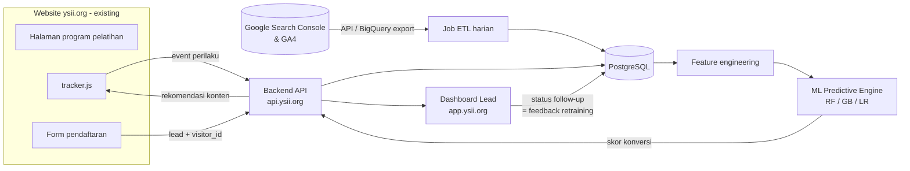

# Langkah-Langkah Membangun Sistem Promosi Digital Terintegrasi Berbasis SEO dan Machine Learning

**Untuk Prediksi Perilaku Calon Peserta Pelatihan — Mitra: Yayasan Sinergi Inspirasi Indonesia (https://ysii.org)**

> **Status implementasi:** sistem pada panduan ini sudah dibangun di repositori ini. Lihat [README](../README.md) untuk cara menjalankan dan deploy, dan [integration/README.md](../integration/README.md) untuk cara memasangnya di website ysii.org (form website + WhatsApp).
> Perbedaan dari rancangan awal di bawah: (1) ada **dua model**, yaitu *lead → peserta* untuk prioritas lead dan *pengunjung → lead* untuk rekomendasi; (2) fitur "hari sejak kunjungan terakhir" diganti "rentang keterlibatan", karena yang pertama membocorkan label; (3) chat WhatsApp dihubungkan ke pengunjung lewat **kode referensi** otomatis di pesan WA.

Dokumen ini adalah panduan teknis pelaksanaan proposal PTI 2026. Urutannya mengikuti 6 tahap dan jadwal 12 minggu di proposal (BAB 3 & Tabel 4.2), dan dirancang agar sistem **ditempel (diintegrasikan) ke website ysii.org yang sudah ada, tanpa membangun ulang website tersebut**.

---

## Daftar Isi

1. [Prinsip Integrasi](#1-prinsip-integrasi)
2. [Arsitektur Sistem (6 Modul)](#2-arsitektur-sistem-6-modul)
3. [Teknologi yang Direkomendasikan](#3-teknologi-yang-direkomendasikan)
4. [Tahap 1 — Analisis Kebutuhan & Audit (Minggu 1–2)](#tahap-1--analisis-kebutuhan--audit-minggu-12)
5. [Tahap 2 — Perancangan Arsitektur (Minggu 3)](#tahap-2--perancangan-arsitektur-minggu-3)
6. [Tahap 3 — Modul SEO & Machine Learning (Minggu 4–7)](#tahap-3--modul-seo--machine-learning-minggu-47)
7. [Tahap 4 — Integrasi & Dashboard (Minggu 8–9)](#tahap-4--integrasi--dashboard-minggu-89)
8. [Tahap 5 — Deployment & Validasi di Mitra (Minggu 10–11)](#tahap-5--deployment--validasi-di-mitra-minggu-1011)
9. [Tahap 6 — Evaluasi, Pelaporan & Luaran (Minggu 12)](#tahap-6--evaluasi-pelaporan--luaran-minggu-12)
10. [Risiko Penting & Mitigasinya](#10-risiko-penting--mitigasinya)
11. [Yang Perlu Disiapkan Mitra](#11-yang-perlu-disiapkan-mitra)
12. [Pembagian Tugas Tim](#12-pembagian-tugas-tim)

---

## 1. Prinsip Integrasi

Website ysii.org tetap berjalan seperti sekarang. Sistem baru berdiri **di samping** website dan terhubung lewat tiga titik:

| Titik integrasi | Cara memasang di website lama | Fungsi |
|---|---|---|
| **Script tracker** (1 baris `<script>`) | Ditempel di `<head>` website (lewat plugin header/footer jika WordPress, atau Google Tag Manager) | Merekam perilaku pengunjung: halaman, durasi, scroll, klik, sumber traffic |
| **Form pendaftaran terintegrasi** | Halaman pendaftaran baru di subdomain, atau form lama ditambah *hidden field* `visitor_id` + webhook | Menghubungkan pengunjung anonim dengan lead yang mendaftar (inilah label untuk ML) |
| **Perbaikan SEO** | Diterapkan langsung di website lama (meta, schema, sitemap, konten) | Menaikkan traffic organik berkualitas |

Komponen baru (API, model ML, dashboard) dipasang di subdomain, misalnya:

- `api.ysii.org` → backend (tracking, scoring, rekomendasi)
- `app.ysii.org` → dashboard manajemen lead (khusus admin mitra)
- `daftar.ysii.org` (opsional) → form pendaftaran terintegrasi

Keuntungannya: risiko merusak website utama kecil, dan arsitekturnya bisa direplikasi ke lembaga pelatihan lain (sesuai target replikasi di proposal) cukup dengan memasang script yang sama.

---

## 2. Arsitektur Sistem (6 Modul)



| No | Modul (sesuai proposal) | Isi utama |
|---|---|---|
| 1 | **SEO Engine** | Optimasi on-page, technical SEO, schema markup, sitemap, monitoring keyword (GSC) |
| 2 | **User Behavior Tracking** | `tracker.js` + endpoint `/collect`, tabel sesi & event |
| 3 | **ML Predictive Engine** | Pipeline CRISP-DM, 3 algoritma, endpoint `/score` |
| 4 | **Dashboard Manajemen Lead** | Daftar lead + skor + segmen (Hot/Warm/Cold), KPI SEO & konversi |
| 5 | **Modul Pendaftaran Terintegrasi** | Form yang membawa `visitor_id`, langsung di-*scoring* saat submit |
| 6 | **Rekomendasi Konten Dinamis** | Widget "program yang cocok untuk Anda" / CTA berdasarkan skor & minat |

Alur *closed-loop learning* (BAB 2.1.3 proposal): data SEO → perilaku → prediksi → tindak lanjut tim pemasaran → hasil (jadi peserta / tidak) → data latih baru → model dilatih ulang.

---

## 3. Teknologi yang Direkomendasikan

Dipilih agar satu bahasa (Python) untuk backend dan ML, murah, dan mudah dikerjakan mahasiswa TRPL.

| Lapisan | Pilihan | Alasan |
|---|---|---|
| Tracker | JavaScript murni (tanpa library), < 5 KB | Tidak memperlambat website (Core Web Vitals tetap baik) |
| Backend API | **Python FastAPI** | Satu bahasa dengan ML; dokumentasi API (Swagger) otomatis untuk "API Spec" |
| Database | **PostgreSQL** | Gratis, kuat untuk data event & analitik |
| ML | **scikit-learn**, (opsional) XGBoost/LightGBM, pandas, joblib | Standar untuk RF, Gradient Boosting, Logistic Regression |
| Eksperimen ML | Jupyter Notebook + MLflow (opsional) | Dokumentasi CRISP-DM & perbandingan model untuk jurnal |
| Dashboard | **React (Vite) + Chart.js**, atau Laravel jika tim lebih nyaman | Antarmuka admin mitra |
| Job terjadwal | cron / APScheduler | ETL harian GSC/GA4, retraining mingguan |
| Deployment | **Docker Compose** di VPS (2 vCPU, 4 GB RAM) + Nginx + Let's Encrypt | Sesuai pos anggaran sewa cloud Rp 2.000.000 |
| Notifikasi (opsional) | WhatsApp link / email | Memberi tahu admin saat ada lead "Hot" |

> Jika website ysii.org berbasis **WordPress**, alternatifnya modul tracker & form bisa dibungkus menjadi plugin WordPress kecil yang memanggil API yang sama. Ini bagus untuk HKI dan replikasi, tetapi tidak wajib.

---

## Tahap 1 — Analisis Kebutuhan & Audit (Minggu 1–2)

**Output: Dokumen SRS + Baseline performa SEO + pengumpulan data sudah berjalan.**

### 1.1 Kenali website saat ini
- [ ] Dapatkan akses admin website ysii.org, hosting/cPanel, dan DNS domain dari mitra.
- [ ] Pastikan platformnya (WordPress / Laravel / HTML statis / builder lain). Cara cepat: buka *View Page Source* lalu cari `wp-content` atau `<meta name="generator">`.
- [ ] Inventaris halaman: beranda, daftar program pelatihan/sertifikasi, halaman detail program, kontak, pendaftaran, artikel/berita.
- [ ] Catat alur pendaftaran saat ini (form website? Google Form? WhatsApp?). **Ini sangat penting**, karena titik pendaftaran adalah sumber label "konversi" untuk ML.

### 1.2 Pasang alat ukur (segera, minggu 1)
- [ ] Verifikasi domain di **Google Search Console** (lewat DNS TXT).
- [ ] Pasang/rapikan **Google Analytics 4** (via GTM lebih fleksibel). Tandai event `generate_lead` / `sign_up` sebagai *key event*.
- [ ] Aktifkan **GA4 → BigQuery export** (gratis, dalam batas sandbox) jika ingin data mentah per-event dari GA4.
- [ ] Ukur baseline dengan **PageSpeed Insights** (LCP, INP/FID, CLS) untuk 5–10 halaman utama, untuk mobile & desktop.

### 1.3 Baseline SEO (pre-test)
Catat dalam spreadsheet, sebab angka ini dibandingkan lagi di Tahap 6 (paired t-test):
- Jumlah klik & impresi organik 3 bulan terakhir (GSC), CTR, rata-rata posisi.
- 20–30 keyword target dan posisinya, contoh: "pelatihan [bidang] Medan", "sertifikasi BNSP [skema] Medan", "kursus [bidang] bersertifikat".
- Jumlah halaman terindeks, error coverage, status sitemap & robots.txt.
- Conversion rate saat ini = pendaftar / pengunjung.

### 1.4 Wawancara stakeholder mitra
Pertanyaan kunci:
- Apa definisi "konversi"? (isi form? bayar? hadir pelatihan?) → tentukan **label ML** (lihat 3.3).
- Program apa yang paling ingin dipromosikan? Siapa target pesertanya?
- Data historis apa yang ada (daftar peserta, data pendaftar sebelumnya)?
- Siapa yang akan memakai dashboard dan apa tindakan follow-up yang dilakukan (telepon, WA, email)?

### 1.5 Mulai kumpulkan data perilaku sejak minggu 2 ⚠️
Model ML butuh data berlabel. Jika tracker baru dipasang minggu 8, data tidak akan cukup untuk dilatih. **Pasang versi awal `tracker.js` + endpoint `/collect` sesegera mungkin (minggu 2)**, walau dashboard belum ada. Lihat kode di 3.2.

### 1.6 Susun SRS
- Kebutuhan fungsional per modul (6 modul di atas).
- Kebutuhan non-fungsional: response time API < 300 ms, uptime ≥ 99%, script tracker < 5 KB, sesuai **UU No. 27/2022 tentang Pelindungan Data Pribadi** (banner persetujuan, kebijakan privasi, hak hapus data).

---

## Tahap 2 — Perancangan Arsitektur (Minggu 3)

**Output: Diagram arsitektur, ERD, API Spec, Mockup UI.**

### 2.1 ERD / skema database (PostgreSQL)

```sql
-- Pengunjung anonim (diidentifikasi cookie first-party)
CREATE TABLE visitors (
  visitor_id      UUID PRIMARY KEY,
  first_seen_at   TIMESTAMPTZ NOT NULL DEFAULT now(),
  first_source    TEXT,          -- google / direct / facebook / instagram / whatsapp
  first_medium    TEXT,          -- organic / cpc / social / referral
  first_campaign  TEXT,
  first_landing   TEXT,          -- URL landing pertama
  device_type     TEXT,          -- mobile / desktop / tablet
  consent         BOOLEAN NOT NULL DEFAULT false
);

-- Satu kunjungan (habis setelah 30 menit tanpa aktivitas)
CREATE TABLE sessions (
  session_id      UUID PRIMARY KEY,
  visitor_id      UUID REFERENCES visitors(visitor_id),
  started_at      TIMESTAMPTZ NOT NULL,
  ended_at        TIMESTAMPTZ,
  source          TEXT,
  medium          TEXT,
  landing_page    TEXT,
  referrer        TEXT,
  utm_term        TEXT,          -- keyword (jika dari iklan / UTM)
  page_count      INT DEFAULT 0,
  duration_sec    INT DEFAULT 0,
  max_scroll_pct  INT DEFAULT 0
);

-- Event detail
CREATE TABLE events (
  id              BIGSERIAL PRIMARY KEY,
  session_id      UUID REFERENCES sessions(session_id),
  visitor_id      UUID REFERENCES visitors(visitor_id),
  ts              TIMESTAMPTZ NOT NULL DEFAULT now(),
  type            TEXT NOT NULL, -- page_view, scroll, click_cta, click_whatsapp, view_price,
                                 -- download_brochure, form_start, form_submit, heartbeat
  page_url        TEXT,
  page_category   TEXT,          -- program / artikel / kontak / beranda
  program_slug    TEXT,          -- program pelatihan yang dilihat
  value           NUMERIC,       -- misal persen scroll / detik aktif
  meta            JSONB
);
CREATE INDEX ON events (visitor_id, ts);

-- Program pelatihan (katalog)
CREATE TABLE programs (
  slug            TEXT PRIMARY KEY,
  name            TEXT NOT NULL,
  category        TEXT,
  price           NUMERIC,
  url             TEXT
);

-- Lead = pengunjung yang mengisi form
CREATE TABLE leads (
  lead_id         BIGSERIAL PRIMARY KEY,
  visitor_id      UUID REFERENCES visitors(visitor_id),
  created_at      TIMESTAMPTZ NOT NULL DEFAULT now(),
  name            TEXT, phone TEXT, email TEXT,
  program_slug    TEXT REFERENCES programs(slug),
  status          TEXT NOT NULL DEFAULT 'baru', -- baru, dihubungi, tertarik, terdaftar, bayar, batal
  converted       BOOLEAN,       -- LABEL untuk ML (diisi tim mitra lewat dashboard)
  converted_at    TIMESTAMPTZ
);

-- Hasil prediksi (riwayat skor)
CREATE TABLE predictions (
  id              BIGSERIAL PRIMARY KEY,
  visitor_id      UUID REFERENCES visitors(visitor_id),
  lead_id         BIGINT REFERENCES leads(lead_id),
  model_version   TEXT NOT NULL,
  score           NUMERIC NOT NULL,  -- probabilitas konversi 0..1
  segment         TEXT NOT NULL,     -- hot / warm / cold
  created_at      TIMESTAMPTZ NOT NULL DEFAULT now()
);

-- Data SEO harian dari Google Search Console
CREATE TABLE gsc_daily (
  date DATE, page TEXT, query TEXT,
  clicks INT, impressions INT, ctr NUMERIC, position NUMERIC,
  PRIMARY KEY (date, page, query)
);

-- Versi model
CREATE TABLE model_registry (
  version TEXT PRIMARY KEY, algorithm TEXT, trained_at TIMESTAMPTZ,
  metrics JSONB, is_active BOOLEAN DEFAULT false, artifact_path TEXT
);
```

### 2.2 Spesifikasi API (ringkas)

| Method | Endpoint | Dipanggil oleh | Fungsi |
|---|---|---|---|
| POST | `/v1/collect` | tracker.js | Terima batch event perilaku |
| POST | `/v1/leads` | form pendaftaran / webhook | Simpan lead + langsung hitung skor |
| GET | `/v1/score/{visitor_id}` | tracker / dashboard | Skor konversi terkini |
| GET | `/v1/recommend/{visitor_id}` | tracker.js | Program/konten yang direkomendasikan |
| GET | `/v1/admin/leads?segment=hot` | dashboard | Daftar lead + skor + filter |
| PATCH | `/v1/admin/leads/{id}` | dashboard | Update status follow-up / label `converted` |
| GET | `/v1/admin/kpi` | dashboard | Ringkasan KPI SEO & konversi |
| POST | `/v1/admin/model/retrain` | admin / cron | Latih ulang model |

Endpoint `/admin/*` wajib login (JWT) dan hanya untuk admin mitra.

### 2.3 Mockup UI (Figma)
- Dashboard: kartu KPI (pengunjung organik, lead, conversion rate, akurasi model), tabel lead berwarna per segmen, grafik tren, daftar keyword teratas.
- Detail lead: perjalanan pengunjung (timeline halaman yang dibuka), skor, alasan skor (fitur paling berpengaruh), tombol WhatsApp.
- Widget rekomendasi di website: kartu "Program yang mungkin cocok" / CTA "Konsultasi gratis via WhatsApp".

---

## Tahap 3 — Modul SEO & Machine Learning (Minggu 4–7)

### 3.1 Modul SEO (Minggu 4–5) — diterapkan di website ysii.org

**A. On-page SEO**
- [ ] Satu halaman khusus (landing page) **per program pelatihan/skema sertifikasi**, dengan URL rapi: `/program/pelatihan-digital-marketing-medan`.
- [ ] Setiap halaman: satu `<h1>` berisi keyword utama, `<title>` ≤ 60 karakter, meta description ≤ 155 karakter yang memuat CTA.
- [ ] Struktur heading H2/H3: "Apa yang dipelajari", "Jadwal & biaya", "Sertifikat", "Instruktur", "FAQ", "Cara daftar".
- [ ] Gambar dikompres (WebP), atribut `alt` deskriptif, *internal link* antar program dan artikel.

**B. Schema markup (JSON-LD)** — penting untuk rich result di Google:

```html
<script type="application/ld+json">
{
  "@context": "https://schema.org",
  "@type": "Course",
  "name": "Pelatihan Digital Marketing Bersertifikat",
  "description": "Pelatihan digital marketing 3 hari di Medan dengan sertifikat kompetensi.",
  "provider": {
    "@type": "EducationalOrganization",
    "name": "Yayasan Sinergi Inspirasi Indonesia",
    "sameAs": "https://ysii.org"
  },
  "hasCourseInstance": {
    "@type": "CourseInstance",
    "courseMode": "onsite",
    "location": "Jl. Darussalam No. 16/22, Medan",
    "startDate": "2026-11-10"
  },
  "offers": { "@type": "Offer", "price": "1500000", "priceCurrency": "IDR", "category": "Paid" }
}
</script>
```

Tambahkan juga `EducationalOrganization` (beranda), `FAQPage` (bagian FAQ), dan `BreadcrumbList`.

**C. Technical SEO**
- [ ] `sitemap.xml` otomatis + didaftarkan di GSC; `robots.txt` tidak memblokir halaman penting.
- [ ] HTTPS, *canonical tag*, redirect 301 untuk URL lama, perbaiki error 404.
- [ ] Core Web Vitals target: LCP < 2,5 s, INP < 200 ms, CLS < 0,1 (cache, lazy-load gambar, kurangi plugin/JS berat).
- [ ] Mobile-friendly (mayoritas calon peserta membuka dari HP).

**D. Konten E-E-A-T (topik YMYL)**
- [ ] Profil yayasan, legalitas, akreditasi/LSP, profil instruktur dengan kredensial.
- [ ] Testimoni & foto kegiatan asli, jumlah alumni, mitra industri.
- [ ] Kalender konten artikel 2 per minggu menjawab pertanyaan calon peserta ("berapa biaya sertifikasi BNSP...", "prospek kerja ...").
- [ ] Google Business Profile untuk SEO lokal "Medan".

**E. Monitoring SEO otomatis** — job harian menarik data GSC ke tabel `gsc_daily`:

```python
# etl/gsc_daily.py — jalankan via cron tiap pagi
from google.oauth2 import service_account
from googleapiclient.discovery import build
import datetime as dt, psycopg

creds = service_account.Credentials.from_service_account_file(
    "secrets/gsc-sa.json", scopes=["https://www.googleapis.com/auth/webmasters.readonly"])
gsc = build("searchconsole", "v1", credentials=creds)

day = (dt.date.today() - dt.timedelta(days=3)).isoformat()  # data GSC tertunda ±2-3 hari
resp = gsc.searchanalytics().query(siteUrl="sc-domain:ysii.org", body={
    "startDate": day, "endDate": day, "dimensions": ["page", "query"], "rowLimit": 25000,
}).execute()

with psycopg.connect("postgresql://...") as conn:
    for r in resp.get("rows", []):
        page, query = r["keys"]
        conn.execute(
            "INSERT INTO gsc_daily VALUES (%s,%s,%s,%s,%s,%s,%s) ON CONFLICT DO NOTHING",
            (day, page, query, r["clicks"], r["impressions"], r["ctr"], r["position"]))
```

(Service account ditambahkan sebagai user di properti GSC.)

### 3.2 Modul User Behavior Tracking (dipasang paling lambat minggu 2–4)

**Script yang ditempel di website** (cukup satu baris di `<head>`):

```html
<script src="https://api.ysii.org/static/tracker.js" defer></script>
```

**`tracker.js`** (versi inti):

```js
(function () {
  var API = "https://api.ysii.org/v1/collect";
  // Hormati persetujuan pengguna (UU PDP). Banner consent menyimpan 'ysii_consent=1'.
  if (localStorage.getItem("ysii_consent") !== "1") return;

  function uuid() { return crypto.randomUUID(); }
  var vid = localStorage.getItem("ysii_vid") || uuid();
  localStorage.setItem("ysii_vid", vid);

  // Sesi berakhir setelah 30 menit tidak aktif
  var now = Date.now(), last = +localStorage.getItem("ysii_last") || 0;
  var sid = (now - last < 30 * 60 * 1000 && localStorage.getItem("ysii_sid")) || uuid();
  localStorage.setItem("ysii_sid", sid);
  localStorage.setItem("ysii_last", now);

  var q = new URLSearchParams(location.search);
  var base = {
    visitor_id: vid, session_id: sid, page_url: location.pathname,
    referrer: document.referrer,
    utm_source: q.get("utm_source"), utm_medium: q.get("utm_medium"),
    utm_campaign: q.get("utm_campaign"), utm_term: q.get("utm_term"),
    program_slug: document.body.dataset.program || null,  // <body data-program="...">
    device: /Mobi/i.test(navigator.userAgent) ? "mobile" : "desktop"
  };
  var buf = [];
  function track(type, extra) { buf.push(Object.assign({ type: type, ts: Date.now() }, extra || {})); }
  function flush() {
    if (!buf.length) return;
    navigator.sendBeacon(API, JSON.stringify({ ctx: base, events: buf }));
    buf = [];
  }

  track("page_view");

  // Kedalaman scroll (25/50/75/100%)
  var marks = {};
  addEventListener("scroll", function () {
    var pct = Math.round((scrollY + innerHeight) / document.documentElement.scrollHeight * 100);
    [25, 50, 75, 100].forEach(function (m) {
      if (pct >= m && !marks[m]) { marks[m] = 1; track("scroll", { value: m }); }
    });
  }, { passive: true });

  // Waktu aktif (hanya saat tab terlihat)
  var active = 0;
  setInterval(function () { if (!document.hidden) active += 5; }, 5000);

  // Klik penting: tandai elemen dengan data-track="click_cta" / "click_whatsapp" / dst.
  document.addEventListener("click", function (e) {
    var el = e.target.closest("[data-track], a[href*='wa.me'], a[href*='whatsapp']");
    if (!el) return;
    track(el.dataset.track || "click_whatsapp", { label: el.textContent.trim().slice(0, 60) });
  });

  // Form: mulai isi & sisipkan visitor_id ke hidden field agar lead tersambung ke perilaku
  document.querySelectorAll("form").forEach(function (f) {
    var h = document.createElement("input");
    h.type = "hidden"; h.name = "visitor_id"; h.value = vid; f.appendChild(h);
    f.addEventListener("focusin", function () { track("form_start"); }, { once: true });
    f.addEventListener("submit", function () { track("form_submit"); flush(); });
  });

  addEventListener("visibilitychange", function () {
    if (document.hidden) { track("heartbeat", { value: active }); flush(); }
  });
  setInterval(flush, 15000);
})();
```

Hal yang perlu ditambahkan di website lama:
- Atribut `data-program="slug-program"` di halaman program, dan `data-track="click_cta"` / `"view_price"` / `"download_brochure"` di tombol penting.
- **Banner persetujuan cookie** + halaman Kebijakan Privasi.

**Endpoint penerima (FastAPI)**:

```python
# app/routers/collect.py
from fastapi import APIRouter, Request
from pydantic import BaseModel

router = APIRouter()

class Ctx(BaseModel):
    visitor_id: str; session_id: str; page_url: str
    referrer: str | None = None; utm_source: str | None = None
    utm_medium: str | None = None; utm_campaign: str | None = None
    utm_term: str | None = None; program_slug: str | None = None; device: str | None = None

class Event(BaseModel):
    type: str; ts: int; value: float | None = None; label: str | None = None

class Payload(BaseModel):
    ctx: Ctx; events: list[Event]

@router.post("/v1/collect", status_code=204)
async def collect(request: Request):
    # sendBeacon mengirim text/plain, jadi body di-parse manual
    p = Payload.model_validate_json(await request.body())
    source, medium = classify_source(p.ctx)   # google→organic, fb/ig→social, utm, dst.
    await upsert_visitor_and_session(p.ctx, source, medium)
    await insert_events(p.ctx, p.events)
```

Atur CORS hanya untuk `https://ysii.org`, dan batasi laju (*rate limit*) per IP untuk mencegah spam.

### 3.3 Modul Machine Learning (Minggu 5–7, CRISP-DM)

**(a) Business understanding — definisi label**

Disepakati dengan mitra di Tahap 1. Rekomendasi bertingkat:

| Label | Definisi | Kapan dipakai |
|---|---|---|
| `lead` | Pengunjung mengisi form / klik WhatsApp | Data cepat terkumpul, cocok untuk awal |
| `converted` | Lead benar-benar mendaftar/membayar (diisi tim mitra di dashboard) | Label utama; makin bernilai seiring waktu |

Unit prediksi: **per pengunjung (visitor)**, dihitung dari seluruh sesinya hingga waktu prediksi.

**(b) Data understanding** — EDA di notebook: distribusi sumber traffic, rasio konversi (biasanya sangat tidak seimbang, misal 1–5%), korelasi fitur.

**(c) Data preparation — fitur (sesuai proposal)**

| Kelompok | Fitur |
|---|---|
| Sesi | jumlah sesi, total & rata-rata durasi aktif, jumlah halaman (page depth), bounce (1 halaman & < 10 s) |
| Scroll | rata-rata & maksimum scroll depth, persen halaman program yang di-scroll ≥ 75% |
| Interaksi | klik CTA, klik WhatsApp, lihat harga/jadwal, unduh brosur, `form_start` |
| Sumber traffic | source/medium (one-hot: organic, direct, social, referral, cpc), landing page category |
| Query intent | kategori intent dari keyword (lihat catatan) — informasional / komersial / lokal / brand |
| Konten | jumlah program berbeda yang dilihat, kategori program, membaca artikel blog |
| Waktu & perangkat | hari/jam kunjungan, mobile/desktop, recency (hari sejak kunjungan terakhir), kunjungan ulang |

> **Catatan penting soal "query pencarian":** Google **tidak** memberikan keyword per pengunjung (sejak 2013, "not provided"). GSC hanya memberi data keyword yang dijumlahkan per halaman. Solusi yang jujur & bisa dipertanggungjawabkan di jurnal:
> 1. Gunakan **landing page** sebagai proksi: dari `gsc_daily`, hitung keyword dominan & intent dari halaman tersebut, lalu jadikan fitur `landing_query_intent`.
> 2. Untuk traffic iklan/kampanye, gunakan `utm_term`.
> 3. Jika ada fitur pencarian internal di website, rekam kata kuncinya (`site_search`).

Tangani ketidakseimbangan kelas dengan `class_weight="balanced"` atau SMOTE (hanya pada data latih).

**(d) Modeling & (e) Evaluation**

```python
# ml/train.py
import pandas as pd, joblib, json
from sklearn.model_selection import StratifiedKFold, cross_validate, train_test_split
from sklearn.pipeline import Pipeline
from sklearn.compose import ColumnTransformer
from sklearn.preprocessing import OneHotEncoder, StandardScaler
from sklearn.linear_model import LogisticRegression
from sklearn.ensemble import RandomForestClassifier, HistGradientBoostingClassifier
from sklearn.metrics import classification_report, roc_auc_score

df = pd.read_sql("SELECT * FROM ml_features", "postgresql://...")  # view fitur per visitor
y = df.pop("converted").astype(int)
cat = ["first_source", "first_medium", "device_type", "landing_category", "landing_query_intent"]
num = [c for c in df.columns if c not in cat + ["visitor_id"]]

prep = ColumnTransformer([
    ("num", StandardScaler(), num),
    ("cat", OneHotEncoder(handle_unknown="ignore"), cat),
])
models = {
    "logreg": LogisticRegression(max_iter=1000, class_weight="balanced"),        # baseline
    "random_forest": RandomForestClassifier(n_estimators=300, class_weight="balanced", random_state=42),
    "gradient_boosting": HistGradientBoostingClassifier(class_weight="balanced", random_state=42),
}

X_tr, X_te, y_tr, y_te = train_test_split(df, y, test_size=0.2, stratify=y, random_state=42)
cv = StratifiedKFold(n_splits=5, shuffle=True, random_state=42)
results = {}
for name, clf in models.items():
    pipe = Pipeline([("prep", prep), ("clf", clf)])
    s = cross_validate(pipe, X_tr, y_tr, cv=cv,
                       scoring=["accuracy", "precision", "recall", "f1", "roc_auc"])
    results[name] = {k: float(v.mean()) for k, v in s.items() if k.startswith("test_")}

best = max(results, key=lambda n: results[n]["test_f1"])   # pilih berdasar F1, bukan akurasi saja
pipe = Pipeline([("prep", prep), ("clf", models[best])]).fit(X_tr, y_tr)
proba = pipe.predict_proba(X_te)[:, 1]
print(classification_report(y_te, proba >= 0.5), "AUC:", roc_auc_score(y_te, proba))

joblib.dump(pipe, f"models/{best}.joblib")
json.dump(results, open("models/metrics.json", "w"), indent=2)
```

Checklist evaluasi untuk laporan & jurnal:
- [ ] Tabel perbandingan 3 algoritma: accuracy, precision, recall, F1, AUC (rata-rata 5-fold ± std).
- [ ] Confusion matrix & kurva ROC model terbaik.
- [ ] *Feature importance* (permutation importance / SHAP) → menjelaskan "perilaku apa yang menandakan calon peserta serius". Ini temuan menarik untuk jurnal.
- [ ] Tuning hyperparameter (GridSearchCV / RandomizedSearchCV) pada model terbaik.
- [ ] Pilih *threshold* segmen: misal **Hot ≥ 0,7**, **Warm 0,4–0,7**, **Cold < 0,4** (disesuaikan dengan kapasitas follow-up tim mitra).

> **Tentang target akurasi 85%:** pada data konversi yang tidak seimbang (misal 3% konversi), model yang selalu menebak "tidak konversi" sudah 97% akurat namun tidak berguna. Laporkan **F1, recall, dan AUC** sebagai metrik utama, dan akurasi sebagai pelengkap. Ini juga memperkuat argumen ilmiah di artikel.

**(f) Deployment model** — endpoint scoring:

```python
# app/routers/score.py
import joblib
model = joblib.load("models/active.joblib")

def segment(p: float) -> str:
    return "hot" if p >= 0.7 else "warm" if p >= 0.4 else "cold"

@router.get("/v1/score/{visitor_id}")
async def score(visitor_id: str):
    X = await build_features_for(visitor_id)   # SQL yang sama dengan view ml_features
    p = float(model.predict_proba(X)[:, 1][0])
    await save_prediction(visitor_id, p, segment(p), MODEL_VERSION)
    return {"visitor_id": visitor_id, "score": round(p, 3), "segment": segment(p)}
```

**Kalau data belum cukup saat minggu 7** (sangat mungkin): jalankan **lead scoring berbasis aturan** (misal klik WhatsApp +30, lihat harga +20, scroll ≥ 75% di halaman program +10, kunjungan ulang +15) sebagai versi awal, sambil data terus terkumpul. Model ML menggantikannya begitu data cukup (target kasar ≥ 100–200 kasus positif). Dataset historis mitra (mis. GA4 BigQuery export lama atau data pendaftar sebelumnya) juga bisa dipakai untuk melatih awal.

---

## Tahap 4 — Integrasi & Dashboard (Minggu 8–9)

**Output: Sistem terintegrasi siap deploy.**

### 4.1 Modul Pendaftaran Terintegrasi
Pilih salah satu, sesuai kondisi website lama:

| Kondisi saat ini | Cara integrasi |
|---|---|
| Form di website (mis. Contact Form 7 / WPForms / form custom) | `tracker.js` sudah menyisipkan hidden field `visitor_id`. Tambahkan webhook/hook yang meneruskan data form ke `POST /v1/leads` |
| Pendaftaran via Google Form / WhatsApp saja | Buat form pendaftaran baru di `daftar.ysii.org` (atau embed di halaman program) yang memanggil `POST /v1/leads`; tombol WhatsApp tetap ada dan kliknya terekam |

Saat lead masuk: simpan → hitung skor → jika **Hot**, kirim notifikasi ke admin (email/WA) agar dihubungi < 1 jam.

### 4.2 Dashboard Manajemen Lead (`app.ysii.org`)
Halaman minimal:
1. **Ringkasan KPI**: pengunjung organik, lead baru, conversion rate, distribusi Hot/Warm/Cold, akurasi model aktif.
2. **Daftar lead**: diurutkan dari skor tertinggi, filter segmen/program/sumber, tombol "Hubungi via WhatsApp".
3. **Detail lead**: timeline halaman yang dikunjungi, sumber traffic, skor & faktor pendorong.
4. **Update status follow-up**: baru → dihubungi → tertarik → terdaftar/bayar/batal. Status akhir otomatis mengisi label `converted` → **data latih baru (closed-loop)**.
5. **SEO**: tren klik/impresi GSC, keyword teratas & perubahan posisi, halaman dengan CTR rendah.
6. **Model**: versi aktif, metrik, tombol retrain (admin teknis).

Login wajib (JWT + password kuat), data pribadi lead hanya terlihat oleh admin yang berwenang.

### 4.3 Modul Rekomendasi Konten Dinamis
Versi sederhana yang realistis untuk 12 minggu:
- `GET /v1/recommend/{visitor_id}` mengembalikan program yang paling sering dilihat pengunjung + program serupa (kategori sama / sering dilihat bersama oleh pengunjung lain = *item co-occurrence*).
- Berdasarkan segmen:
  - **Cold** → tampilkan artikel edukatif / lead magnet (brosur, info jadwal).
  - **Warm** → tampilkan testimoni + jadwal batch terdekat.
  - **Hot** → tampilkan CTA kuat "Daftar sekarang / Konsultasi via WhatsApp".
- `tracker.js` memanggil endpoint ini dan mengisi elemen `<div id="ysii-reco"></div>` di halaman.

### 4.4 Pengujian sebelum deploy
- [ ] Unit test (pytest) untuk feature engineering & endpoint.
- [ ] Uji end-to-end: kunjungi website → event tercatat → isi form → lead muncul di dashboard dengan skor.
- [ ] Uji beban ringan (Locust/k6) untuk `/v1/collect`, ukur response time & request per detik (parameter "Performa Sistem" di proposal).
- [ ] Pastikan PageSpeed website **tidak turun** setelah tracker dipasang.

---

## Tahap 5 — Deployment & Validasi di Mitra (Minggu 10–11)

### 5.1 Deployment
```yaml
# docker-compose.yml (ringkas)
services:
  db:
    image: postgres:16
    volumes: [pgdata:/var/lib/postgresql/data]
    environment: { POSTGRES_PASSWORD: ${DB_PASSWORD} }
  api:
    build: ./backend
    environment: { DATABASE_URL: postgresql://postgres:${DB_PASSWORD}@db/ysii }
    depends_on: [db]
  dashboard:
    build: ./dashboard
  scheduler:
    build: ./backend
    command: python -m jobs.scheduler   # ETL GSC harian, retrain mingguan
    depends_on: [db]
  nginx:
    image: nginx:stable
    ports: ["80:80", "443:443"]
volumes: { pgdata: {} }
```
- [ ] Sewa VPS (atau infrastruktur mitra), arahkan DNS `api.` dan `app.` ysii.org ke VPS.
- [ ] HTTPS via Let's Encrypt (certbot), firewall hanya port 80/443/SSH.
- [ ] Backup database harian otomatis; monitoring uptime (mis. UptimeRobot).
- [ ] Tempel `tracker.js`, banner consent, schema markup, dan form ke website ysii.org.

### 5.2 Validasi (4 minggu terakhir, sesuai batasan penelitian)
- [ ] **UAT** bersama admin mitra berdasarkan skenario di SRS.
- [ ] **Pelatihan admin mitra**: membaca dashboard, menindaklanjuti lead Hot, mengisi status konversi.
- [ ] **Uji akurasi prediksi pada data operasional**: bandingkan segmen yang diprediksi vs. hasil nyata lead.
- [ ] **Kuesioner SUS** (10 butir) untuk admin mitra & calon peserta.
- [ ] Wawancara mendalam & FGD (fase kualitatif).

---

## Tahap 6 — Evaluasi, Pelaporan & Luaran (Minggu 12)

### 6.1 Evaluasi terhadap parameter di proposal (BAB 3.3)

| Parameter | Diukur dengan | Pre-test | Post-test |
|---|---|---|---|
| Performa SEO | Posisi keyword, klik organik, CWV, PageSpeed | Tahap 1 | Minggu 12 |
| Akurasi model | Accuracy, precision, recall, F1, AUC | — | Tahap 3 & validasi Tahap 5 |
| Performa sistem | Response time API, uptime, req/detik | — | Tahap 4–5 |
| Indikator bisnis | Conversion rate, lead quality score | Tahap 1 | Minggu 12 |
| Penerimaan pengguna | Skor SUS (target ≥ 68) | — | Tahap 5 |

Analisis: statistik deskriptif, **paired t-test** pre vs. post, thematic analysis untuk data kualitatif, lalu triangulasi.

### 6.2 Luaran
- [ ] **Prototype** berjalan di lingkungan mitra (TKT 6), dengan dokumentasi instalasi agar bisa direplikasi.
- [ ] **HKI Hak Cipta Program Komputer**: siapkan manual book, potongan source code (halaman awal & akhir), screenshot, surat pernyataan, dan daftarkan via e-hakcipta DJKI. Bisa mulai disiapkan minggu 10.
- [ ] **Artikel jurnal SINTA 4**: arsitektur integrasi SEO-ML, perbandingan 3 algoritma, feature importance, hasil pre/post.
- [ ] **Buku monograf ber-ISBN**: panduan replikasi sistem untuk lembaga pelatihan vokasi.

---

## 10. Risiko Penting & Mitigasinya

| Risiko | Dampak | Mitigasi |
|---|---|---|
| Data konversi terlalu sedikit dalam 12 minggu | Model ML tidak andal | Pasang tracker sejak minggu 2; pakai label bertingkat (lead → converted); rule-based scoring sebagai cadangan; manfaatkan data historis mitra |
| Keyword per pengunjung tidak tersedia dari Google | Fitur "query" tidak bisa langsung dipakai | Proksi landing page + GSC, `utm_term`, pencarian internal (lihat 3.3) |
| Akurasi tinggi tapi menyesatkan karena data tidak seimbang | Klaim di jurnal lemah | Laporkan F1, recall, AUC; gunakan stratified CV |
| Tracker memperlambat website | SEO turun | Script < 5 KB, `defer`, `sendBeacon`, uji PageSpeed sebelum/sesudah |
| Pelanggaran data pribadi (UU PDP) | Risiko hukum | Banner consent, kebijakan privasi, data lead terenkripsi saat transit (HTTPS), akses dashboard dibatasi, retensi data jelas |
| Akses website/hosting mitra terlambat | Jadwal mundur | Minta akses di minggu 1; siapkan staging (salinan website) |
| Tim mitra tidak mengisi status konversi | Tidak ada label baru (closed-loop putus) | UI update status 1 klik; pelatihan; pengingat mingguan |

---

## 11. Yang Perlu Disiapkan Mitra

1. Akses admin website ysii.org, hosting/cPanel, dan pengelola DNS domain.
2. Akses (atau menambahkan tim sebagai user) Google Search Console & GA4; jika belum ada, izin membuatnya.
3. Data program pelatihan: nama, deskripsi, jadwal, biaya, skema sertifikasi, instruktur.
4. Data pendaftar/peserta historis (jika ada) untuk data awal dan validasi, dengan persetujuan penggunaan data.
5. Satu PIC admin yang akan memakai dashboard dan menindaklanjuti lead.
6. Konten E-E-A-T: legalitas, foto kegiatan, testimoni alumni.
7. Infrastruktur deployment (VPS/cloud) atau persetujuan memakai VPS dari anggaran penelitian.

---

## 12. Pembagian Tugas Tim

Usulan pembagian sesuai bidang keahlian di proposal:

| Anggota | Fokus |
|---|---|
| Ketua (Software Engineering) | Arsitektur, SRS, API spec, integrasi, koordinasi mitra, HKI |
| Anggota 1 (AI & Data Science) | Pipeline CRISP-DM, feature engineering, training & evaluasi model, artikel |
| Anggota 2 (SPK & Data Mining) | Segmentasi lead, threshold scoring, rekomendasi konten, analisis statistik pre/post |
| Anggota Mitra | Validasi kebutuhan, akses data & infrastruktur, UAT |
| Mahasiswa 1–2 | Backend FastAPI, database, tracker.js |
| Mahasiswa 3 | Dashboard (frontend) |
| Mahasiswa 4 | Implementasi SEO on-page/technical/schema & konten |
| Mahasiswa 5 | Deployment (Docker, VPS), testing, dokumentasi & manual book |

---

## Ringkasan Urutan Kerja

1. **Minggu 1**: akses website & GSC/GA4, audit platform, baseline SEO.
2. **Minggu 2**: wawancara mitra, SRS, **tracker.js + /collect sudah live** (mulai kumpulkan data).
3. **Minggu 3**: ERD, API spec, mockup.
4. **Minggu 4–5**: perbaikan SEO di ysii.org (landing page program, schema, CWV, konten).
5. **Minggu 5–7**: feature engineering, latih & bandingkan RF / GB / LR, endpoint `/score`.
6. **Minggu 8–9**: form pendaftaran terintegrasi, dashboard lead, rekomendasi konten, pengujian.
7. **Minggu 10–11**: deploy, UAT, pelatihan admin, SUS, validasi akurasi di data nyata; siapkan HKI.
8. **Minggu 12**: analisis pre/post, laporan akhir, artikel jurnal, draft monograf.
